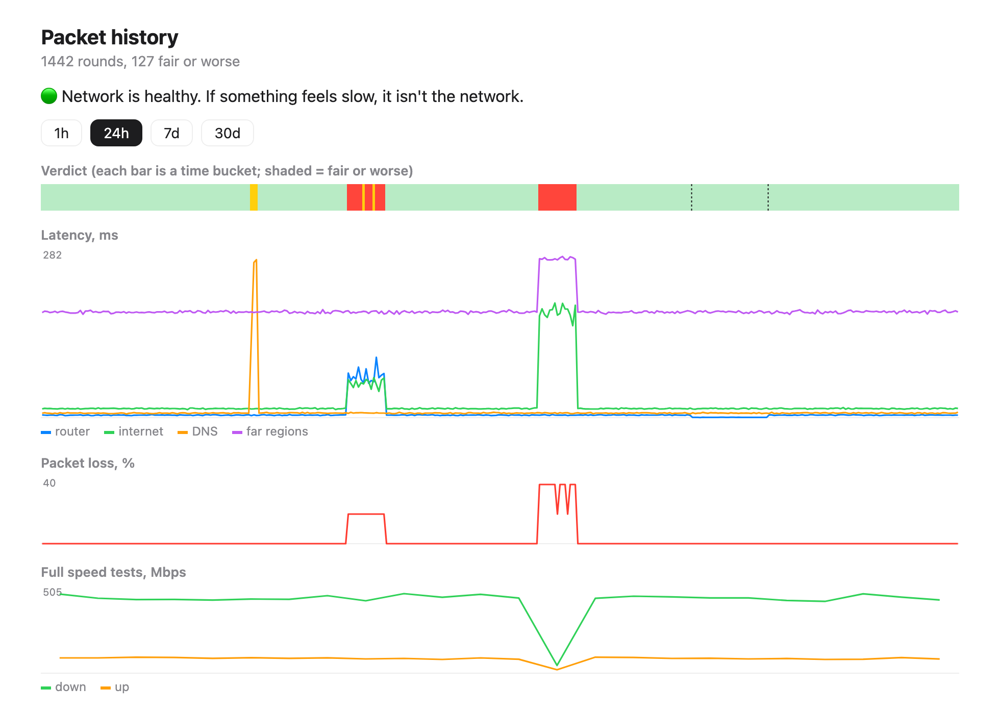

# go-packet

**Is it the network?** `packet` checks every layer of your Mac's connection once a minute and tells
you in one sentence which layer is to blame: Wi-Fi, local network, internet provider, DNS, or far
internet. When everything is green, stop blaming the Wi-Fi and go look at the app.

> **This is a Go port of [Packet](https://github.com/danielmiessler/packet) by
> [Daniel Miessler](https://github.com/danielmiessler).** The idea, the measurements, the
> thresholds and the database schema all come from his project (MIT licensed, and this repo keeps
> his copyright and licence; see [LICENSE](LICENSE)). Go to the original for the polished Mac app
> with its own menu bar icon and history window. Thank you, Daniel.



<sub>The screenshot is a made-up day (`packet demo`), not a real network.</sub>

## What's different here

The original is a Rust app with a tray icon and a window. This port is a headless Go program:

- `packet daemon` measures every minute and serves a small **localhost API**, plus a simple history
  page at `http://127.0.0.1:47831/`. Put any UI you like on top (a menu bar app, a status bar
  script, a dashboard).
- A CLI answers from the terminal: `packet now`, `packet at 14:30`, `packet history`.
- Same layer-by-layer verdict, same baselines learned from your own history, and the same SQLite
  schema, so either program can read the other's database.
- Bandwidth tests use Go's `net/http` instead of shelling out to `curl`.

macOS only (Apple Silicon tested). It reads Wi-Fi signal through CoreWLAN and the path's
expensive/constrained flags through Network.framework, via two small Objective-C bridges.

## Install

You need macOS 14+, the Xcode Command Line Tools and Go.

```bash
go install github.com/cleonte/go-packet/cmd/packet@latest
```

or from a checkout:

```bash
make build     # bin/packet
make test      # go vet + go test -race
make install   # also copies the CLI to ~/.local/bin
```

## Use

```
packet daemon                   measure every minute and serve the local API (127.0.0.1)
packet status [--json]          what the running daemon last measured
packet now [--json]             measure every layer now
packet test [--json]            measure now plus a full bandwidth test
packet at <WHEN> [--json]       what the network was like then: 14:30, 2026-10-12 14:30, 30m, 2h, 3d
packet history [--range R] [--json]
packet hourly on|off            hourly line-speed test (about 3.4 GB/day, off by default)
packet version                  which build this is
packet demo DIR                 write a made-up day of data into DIR (screenshots, UI work)
```

Data lives in `~/Library/Application Support/Packet/packet.sqlite` (kept 90 days).
`PACKET_DATA_DIR` overrides it and `PACKET_PORT` changes the API port.

Logs go to stderr. `PACKET_LOG=debug|info|warn|error` sets the level (default `info` for the
daemon, `warn` for one-shot commands). `debug` logs every round; `info` logs verdict changes, wakes
from sleep, network changes and bandwidth tests.

## How it measures

Every 60 seconds, one round:

| Layer | What is measured |
|---|---|
| Link | Ethernet or Wi-Fi; on Wi-Fi, signal, noise, rate and channel |
| Router | 5 ICMP pings to the default gateway |
| Internet | 5 ICMP pings to `1.1.1.1` (TCP fallback), plus the Cloudflare data center that answered |
| DNS | one lookup sent straight to the system resolver |
| World | a TCP handshake to AWS DynamoDB endpoints in 8 regions on 5 continents |

The verdict names the worst layer. Wi-Fi and router are judged against fixed thresholds; internet,
DNS and the far regions against your own recent normal. One bad round is held; two in a row change
the verdict. Bandwidth runs on a light schedule (a ~14 MB check every 10 minutes); a full test only
when you ask, or hourly if you turn that on. See the
[original README](https://github.com/danielmiessler/packet#how-it-measures) for the reasoning.

Packet records numbers about the path, never anything about your traffic. These are the only hosts
it contacts: your gateway, `1.1.1.1`, `speed.cloudflare.com`, the 8 AWS endpoints, your DNS
resolver, and (on `packet test`) Apple's `networkQuality` servers.

## API (127.0.0.1 only)

| | |
|---|---|
| `GET /` | history page |
| `GET /v1/status` | latest round, verdict, per-layer rows (long and short text), bandwidth |
| `GET /v1/history?range=1h\|24h\|7d\|30d` | bucketed history |
| `POST /v1/test` | run a full test now |
| `POST /v1/hourly?on=1\|0` | toggle the hourly test |
| `GET /v1/health` | liveness and the running version |

POSTs need an `X-Packet: 1` header, and every request needs a loopback `Host`. That blocks
cross-site and DNS-rebinding requests from web pages.

## Running the daemon

Run it from a terminal, or from a **parent app** such as a menu bar app. Don't run it as a bare
launchd agent: macOS Local Network privacy blocks such binaries from the LAN, so the router layer
can't be pinged (a child of an app is allowed, and a terminal counts as an app). The Internet, DNS
and World layers are unaffected either way.

## Development

```bash
make test                                   # go vet + go test -race
packet demo /tmp/demo                       # write a made-up day of data into a fresh directory
PACKET_DATA_DIR=/tmp/demo PACKET_PORT=47999 packet daemon   # then open http://127.0.0.1:47999/
```

`packet demo` is seeded, so it produces the same day every time, and it refuses to write into your
real data directory or over an existing database. See [CONTRIBUTING.md](CONTRIBUTING.md).

## Layout

The usual Go layout (`cmd/` for binaries, `internal/` for packages):

```
cmd/packet/          the binary: CLI commands and the daemon entry point
internal/probe/      measurements: link, ICMP, DNS, TCP, bandwidth, one round (+ CoreWLAN/Network bridges)
internal/verdict/    which layer is to blame, and the plain-words sentence
internal/store/      the SQLite database, baselines
internal/sampler/    the minute loop and the bandwidth schedule
internal/report/     plain-words rows and JSON for the CLI and API
internal/history/    bucketed history for charts
internal/server/     the localhost API and history page
internal/clock/      time helpers and the `packet at` parser
internal/num/        helpers for optional numbers
```

Dependencies point one way: `probe` knows nothing of `verdict`, `verdict` nothing of `store`, up to
`cmd/packet`. Tests sit beside the code; `internal/probe/probetest` has the shared fixture.

## Security

See [SECURITY.md](SECURITY.md). The API is localhost-only; please report problems privately.

## License

[MIT](LICENSE). Copyright (c) 2026 Daniel Miessler (the original Packet) and Cristian Leonte (this port).
